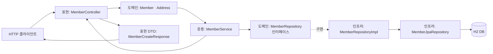

# 회원 가입 API를 DDD 4계층으로 읽기

이 문서는 현재 코드의 `POST http://localhost:8080/member/signup`을 과제 설명용으로 정리한 것이다. 아래의 계층 구분은 **현재 구현을 DDD의 표현·응용·도메인·인프라 4계층에 대응**한 것이다.

## 1. 요청과 응답

| 항목 | 현재 구현 |
| --- | --- |
| HTTP 메서드와 경로 | `POST /member/signup` |
| 요청 형식 | `Content-Type: application/json`, JSON 본문 |
| 성공 응답 | `200 OK`, JSON 본문 |
| 서버 포트 | `8080` ([설정](src/main/resources/application.yml)) |

요청 본문은 주소를 별도 객체로 감싸지 않는 **평평한 구조**다. 필드 이름은 [MemberCreateRequest](src/main/java/jpabook/jpashop/member/presentation/dto/MemberCreateRequest.java)의 record 구성 요소와 일치해야 한다.

```json
{
  "username": "memberA",
  "city": "Seoul",
  "street": "Wangsimli",
  "zipcode": "12345"
}
```

| 요청 필드 | Java 타입 | 용도 |
| --- | --- | --- |
| `username` | `String` | 회원 이름. `Member.username`은 DB에서 `null`을 허용하지 않음 |
| `city` | `String` | 주소의 도시 |
| `street` | `String` | 주소의 거리 |
| `zipcode` | `String` | 주소의 우편번호 |

현재 컨트롤러에는 `@Valid`가 없고, 요청 DTO에도 필드별 검증 어노테이션이 없다. 따라서 이 표는 입력 형식을 설명하며, 모든 값에 대한 사전 검증이 구현됐다는 뜻은 아니다. `username`의 `null` 제약은 [Member 엔티티](src/main/java/jpabook/jpashop/member/domain/Member.java)에 선언되어 있다.

성공하면 [MemberCreateResponse](src/main/java/jpabook/jpashop/member/presentation/dto/MemberCreateResponse.java)와 [AddressResponse](src/main/java/jpabook/jpashop/member/presentation/dto/AddressResponse.java)가 다음 모양으로 직렬화된다. `id`는 DB가 생성하므로 아래 숫자는 예시다.

```json
{
  "id": 1,
  "username": "memberA",
  "addressResponse": {
    "city": "Seoul",
    "street": "Wangsimli",
    "zipcode": "12345"
  }
}
```

컨트롤러에 `@ResponseStatus(CREATED)`나 별도 응답 상태 지정이 없으므로 성공 시 기본 상태인 `200 OK`를 반환한다. 오류 응답을 위한 별도 예외 처리·응답 DTO는 현재 코드에 정의되어 있지 않다.

다음 요청으로 정상 응답을 확인할 수 있다.

```bash
curl -i -X POST http://localhost:8080/member/signup \
  -H 'Content-Type: application/json' \
  -d '{"username":"memberA","city":"Seoul","street":"Wangsimli","zipcode":"12345"}'
```

위 예시 요청은 별도 포트와 인메모리 H2로 실행한 앱에서 `200` 및 위 JSON 구조로 확인했다. 기본 설정의 H2 TCP DB에 대해서는 실행하지 않았다.

## 2. DDD 4계층에 대응한 코드

| 계층 | 현재 파일 | 이 요청에서 하는 일 |
| --- | --- | --- |
| 표현 계층 (Presentation) | [MemberController](src/main/java/jpabook/jpashop/member/presentation/MemberController.java), [요청 DTO](src/main/java/jpabook/jpashop/member/presentation/dto/MemberCreateRequest.java), [응답 DTO](src/main/java/jpabook/jpashop/member/presentation/dto/MemberCreateResponse.java) | HTTP 요청 DTO를 회원 객체로 변환하고, 서비스가 반환한 회원을 응답 DTO로 변환 |
| 응용 계층 (Application) | [MemberService](src/main/java/jpabook/jpashop/member/application/MemberService.java) | 회원을 저장하고 저장된 ID로 다시 조회해 반환 |
| 도메인 계층 (Domain) | [Member](src/main/java/jpabook/jpashop/member/domain/Member.java), [Address](src/main/java/jpabook/jpashop/member/domain/vo/Address.java), [MemberRepository](src/main/java/jpabook/jpashop/member/domain/MemberRepository.java) | 회원과 주소를 표현하고 저장소가 제공해야 할 기능을 선언 |
| 인프라 계층 (Infrastructure) | [MemberRepositoryImpl](src/main/java/jpabook/jpashop/member/infra/MemberRepositoryImpl.java), [MemberJpaRepository](src/main/java/jpabook/jpashop/member/infra/MemberJpaRepository.java) | 도메인 저장소 인터페이스를 구현하고 Spring Data JPA로 DB에 저장 |



## 3. 실제 내부 처리 순서

1. [MemberController.signup()](src/main/java/jpabook/jpashop/member/presentation/MemberController.java)은 `/member`와 `/signup` 경로를 합쳐 `POST /member/signup`을 처리한다. `@RequestBody`가 JSON을 `MemberCreateRequest`로 받는다.
2. 컨트롤러는 요청 DTO의 `to()`를 호출한다. 이 메서드가 `Address.of(city, street, zipcode)`와 `Member.create(username, address)`로 도메인 객체를 만든다.
3. 컨트롤러는 생성한 `Member`를 [MemberService.signup()](src/main/java/jpabook/jpashop/member/application/MemberService.java)에 전달한다.
4. 서비스는 도메인 인터페이스 `MemberRepository.save(member)`를 호출한다. 실제 빈인 `MemberRepositoryImpl`이 `MemberJpaRepository.save(member)`에 위임한다.
5. Spring Data JPA가 회원을 저장한다. `Member.id`는 `GenerationType.IDENTITY`로 생성된다. 서비스는 `save()`가 반환한 ID로 `findById()`를 호출해 회원을 다시 조회하고, 조회 결과가 없으면 `IllegalStateException`을 던진다.
6. 컨트롤러는 반환된 회원을 `MemberCreateResponse.from(saved)`로 응답 DTO에 담고, `@RestController`가 이를 JSON으로 반환한다.

현재 [MemberService](src/main/java/jpabook/jpashop/member/application/MemberService.java)에는 `@Transactional`이 없다. 이 API의 저장과 재조회는 각각 Spring Data JPA의 `save()`와 `findById()`가 제공하는 트랜잭션에서 실행된다. 두 작업을 하나의 트랜잭션으로 묶어야 한다면 응용 계층 메서드에 트랜잭션 경계를 둘 수 있다.

## 4. 과제에서 구분할 구현 범위

- 응용 계층의 `MemberService`는 표현 계층 DTO를 import하지 않는다. 컨트롤러가 요청 DTO를 도메인 객체로 변환하고 서비스 결과를 응답 DTO로 변환한다.
- 요청 DTO의 `to()` 메서드는 현재 회원 가입 흐름에서 호출된다. 서비스는 저장 후 `findById()`를 한 번 더 호출한다. JPA 영속성 컨텍스트에 회원이 남아 있다면 이 호출이 별도의 `SELECT` SQL을 실행하지 않을 수도 있다.
- 회원 이름 중복 확인, 명시적인 입력 검증, 가입 실패 시 통일된 오류 응답은 현재 구현에 없다. 이 문서는 해당 기능이 있다고 가정하지 않는다.
- 기본 [DB 설정](src/main/resources/application.yml)은 로컬 H2 TCP 연결과 `ddl-auto: create`를 사용한다. 앱을 시작하면 연결된 DB 스키마에 영향을 줄 수 있으므로 과제 실행 환경의 DB 설정을 먼저 확인해야 한다.
