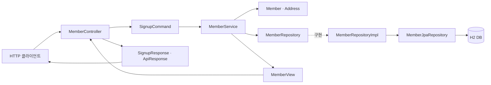

# 회원 가입 API를 DDD 4계층으로 읽기

이 문서는 현재 코드의 `POST /member/signup`을 표현·응용·도메인·인프라 계층에 대응해 설명한다.

## 1. 요청과 응답

| 항목 | 현재 구현 |
| --- | --- |
| HTTP 메서드와 경로 | `POST /member/signup` |
| 요청 형식 | `Content-Type: application/json`, JSON 본문 |
| 성공 응답 | `201 Created`, JSON 본문 |
| 서버 포트 | `8080` ([설정](src/main/resources/application.yml)) |

요청 본문은 [SignupRequest](src/main/java/jpabook/jpashop/member/presentation/dto/SignupRequest.java)의 필드처럼 주소를 별도 객체로 감싸지 않는다.

```json
{
  "username": "memberA",
  "password": "example-password",
  "email": "memberA@example.com",
  "city": "Seoul",
  "street": "Wangsimli",
  "zipcode": "12345"
}
```

`username`, `password`, `email`에는 `@NotBlank`가, `email`에는 `@Email`이 선언되어 있다. [MemberController.signup()](src/main/java/jpabook/jpashop/member/presentation/MemberController.java)은 `@Valid`로 요청 DTO의 검증을 실행한다. 주소 필드에는 별도 검증 어노테이션이 없다. 비밀번호는 [PasswordConfig](src/main/java/jpabook/jpashop/config/PasswordConfig.java)의 `BCryptPasswordEncoder`로 인코딩한 뒤 회원 엔티티에 저장한다.

성공하면 컨트롤러가 [SignupResponse](src/main/java/jpabook/jpashop/member/presentation/dto/SignupResponse.java)를 [ApiResponse](src/main/java/jpabook/jpashop/common/response/ApiResponse.java)의 `data`에 담아 반환한다. 응답에는 비밀번호와 회원 ID가 포함되지 않는다. `ApiResponse`의 값이 `null`인 필드는 JSON에서 제외된다.

```json
{
  "success": true,
  "data": {
    "username": "memberA",
    "email": "memberA@example.com",
    "memberAddressResponse": {
      "city": "Seoul",
      "street": "Wangsimli",
      "zipcode": "12345"
    }
  }
}
```

회원 이름이나 이메일이 이미 존재하면 [MemberService](src/main/java/jpabook/jpashop/member/application/MemberService.java)가 회원별 예외를 던진다. [MemberExceptionHandler](src/main/java/jpabook/jpashop/member/domain/exception/MemberExceptionHandler.java)는 해당 예외의 오류 코드와 메시지를 사용해 `409 Conflict`와 `ApiResponse.fail(...)`을 반환한다. 예를 들어 `memberA`라는 회원 이름이 중복되면 다음 형태다.

```json
{
  "success": false,
  "message": "중복된 아이디의 회원이 존재합니다.: memberA"
}
```

`IllegalArgumentException`은 `400 Bad Request`로 처리한다. 그 밖의 예외를 처리하는 공통 핸들러와 요청 DTO 검증 실패를 따로 처리하는 핸들러는 현재 없다.

다음은 요청 형식의 예시다.

```bash
curl -i -X POST http://localhost:8080/member/signup \
  -H 'Content-Type: application/json' \
  -d '{"username":"memberA","password":"example-password","email":"memberA@example.com","city":"Seoul","street":"Wangsimli","zipcode":"12345"}'
```

## 2. DDD 4계층에 대응한 코드

| 계층 | 현재 파일 | 이 요청에서 하는 일 |
| --- | --- | --- |
| 표현 계층 (Presentation) | [MemberController](src/main/java/jpabook/jpashop/member/presentation/MemberController.java), [SignupRequest](src/main/java/jpabook/jpashop/member/presentation/dto/SignupRequest.java), [SignupResponse](src/main/java/jpabook/jpashop/member/presentation/dto/SignupResponse.java), [MemberAddressResponse](src/main/java/jpabook/jpashop/member/presentation/dto/MemberAddressResponse.java) | HTTP 요청을 응용 계층 명령으로 바꾸고 결과를 HTTP 응답으로 변환 |
| 응용 계층 (Application) | [MemberService](src/main/java/jpabook/jpashop/member/application/MemberService.java), [SignupCommand](src/main/java/jpabook/jpashop/member/application/dto/SignupCommand.java), [MemberView](src/main/java/jpabook/jpashop/member/application/dto/MemberView.java) | 중복 확인, 비밀번호 인코딩, 회원 저장을 조정하고 결과 DTO 반환 |
| 도메인 계층 (Domain) | [Member](src/main/java/jpabook/jpashop/member/domain/Member.java), [Address](src/main/java/jpabook/jpashop/member/domain/vo/Address.java), [MemberRepository](src/main/java/jpabook/jpashop/member/domain/MemberRepository.java), [회원 예외](src/main/java/jpabook/jpashop/member/domain/exception) | 회원·주소와 저장소 계약, 회원 오류 코드 표현 |
| 인프라 계층 (Infrastructure) | [MemberRepositoryImpl](src/main/java/jpabook/jpashop/member/infra/MemberRepositoryImpl.java), [MemberJpaRepository](src/main/java/jpabook/jpashop/member/infra/MemberJpaRepository.java) | 도메인 저장소 계약을 Spring Data JPA로 구현 |



## 3. 실제 내부 처리 순서

1. `MemberController.signup()`은 JSON을 `SignupRequest`로 받고 `@Valid`를 실행한 뒤 `toCommand()`로 `SignupCommand`를 만든다.
2. `MemberService.signup()`은 `MemberRepository.existsByUsername()`과 `existsByEmail()`로 중복을 확인한다. 중복이면 각각 `DuplicatedUsername` 또는 `DuplicatedEmail`을 던진다.
3. 서비스는 `PasswordEncoder.encode()`로 비밀번호를 인코딩한다. `SignupCommand.toEntity(passwordHash)`가 `Address`와 `Member`를 만든다.
4. 서비스는 `MemberRepository.register(member)`를 호출한다. `MemberRepositoryImpl`은 `MemberJpaRepository.save(member)`에 위임한다.
5. 서비스는 저장된 `Member`를 `MemberView`로 변환해 반환한다. 이 메서드에는 `@Transactional`이 선언되어 있으며 저장 후 `findById()`로 다시 조회하지 않는다.
6. 컨트롤러는 `MemberView`를 `SignupResponse`로 변환하고 `ApiResponse.ok(signupResponse)`를 `201 Created`로 반환한다.

## 4. 검증 범위와 실행 환경

HTTP 요청·응답 직렬화는 현재 자동 테스트로 검증되지 않았다.

기본 [DB 설정](src/main/resources/application.yml)은 로컬 H2 TCP 연결과 `ddl-auto: create`를 사용한다. 기본 설정으로 앱을 시작하면 연결된 DB 스키마에 영향을 줄 수 있으므로 실행 환경의 DB 설정을 먼저 확인해야 한다.
